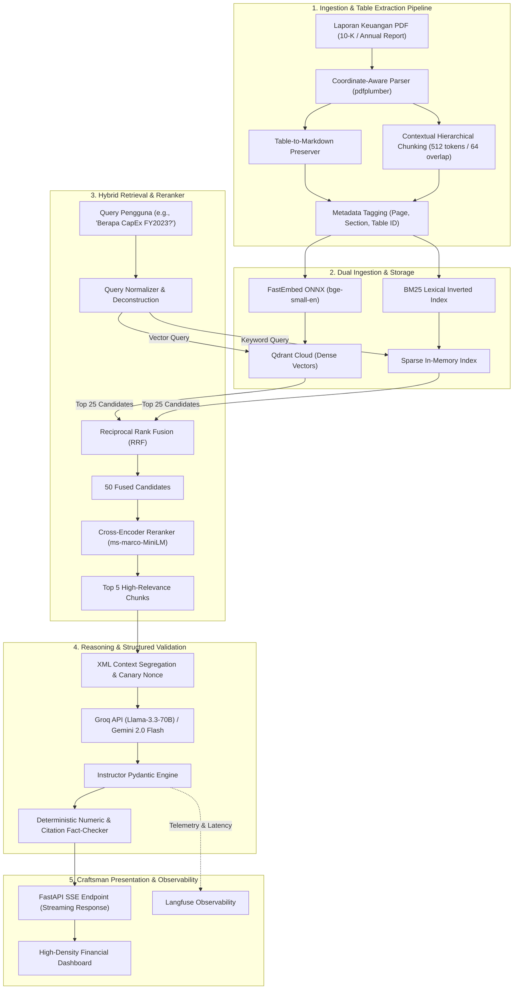

# Product Requirements Document (PRD) & Technical Specification
## Project: ApexFin AI — Production-Grade Financial Intelligence & Audit-Ready Hybrid RAG Engine

---

## 1. Executive Summary & Objective

### 1.1 Problem Statement
Laporan keuangan perusahaan publik (seperti dokumen SEC Form 10-K, 10-Q, prospektus IPO, dan laporan tahunan) memiliki karakteristik data yang sangat menantang bagi arsitektur Retrieval-Augmented Generation (RAG) konvensional:
1. **Pemisahan Tabel yang Rusak (*Table Shredding*):** *Chunking* berbasis karakter/token naif memotong tabel multi-kolom di tengah jalan, menghilangkan relasi baris-kolom dan konteks header.
2. **Toleransi Nol terhadap Halusinasi (*Zero Hallucination Tolerance*):** Kesalahan 1 digit pada metrik seperti EBITDA, *Debt-to-Equity Ratio*, atau *Free Cash Flow* dapat membatalkan analisis investasi.
3. **Ketidakmampuan Pencarian Sintaksis vs Semantik:** Vektor dense sering gagal membedakan kode akun spesifik, nomor regulasi (*Item 8 Financial Statements*), atau kode emiten (*ticker symbols*), sementara *keyword search* murni gagal menangkap konteks semantik makroekonomi.
4. **Ketiadaan Sitasi Audit (*Auditability Deficit*):** Model AI generik menjawab tanpa menyertakan nomor halaman, koordinat kutipan, atau kutipan teks verbatim yang dapat diverifikasi oleh analis keuangan.

### 1.2 Solution Vision
**ApexFin AI** adalah platform *Financial Intelligence* kelas produksi yang dibangun dengan standar *Software Craftsmanship*, arsitektur heksagonal (*Hexagonal/Clean Architecture*), dan pipeline RAG mutakhir (*Hybrid Search + Cross-Encoder Re-Ranking + Table-Preserving Extraction + Guaranteed Pydantic Validation*).

Sistem ini didesain khusus agar dapat dijalankan secara lancar, responsif, dan hemat sumber daya pada mesin lokal (RAM 8 GB) dengan mendelegasikan komputasi berat ke **Free-Tier Cloud LLM berlatensi rendah (Groq API Llama-3.3-70B & Google Gemini 2.0 Flash)** dan **Qdrant Cloud Free-Tier**.

### 1.3 Target Audience & Recruiter Value Proposition
* **Pengguna Utama:** Analis Ekuitas, Auditor Keuangan, Manajer Investasi, dan Konsultan Risiko.
* **Sinyal Teknis untuk Tech Recruiter / Engineering Manager:**
  - Kemampuan mendesain *production-grade RAG pipeline* tanpa ketergantungan pada abstraksi rapuh (*brittle abstractions*).
  - Validasi data ketat menggunakan *runtime schema enforcement* (Pydantic / Instructor).
  - Metrik evaluasi kuantitatif (Ragas *Faithfulness* & *Context Precision*).
  - Implementasi *DevSecOps*, *Prompt Injection defense* (XML segregation & Canary tokens), dan *observability* (Langfuse tracing).
  - UI/UX tingkat *craftsman* (High-Density Data Engine, WCAG 2.1 AA, pencegahan layout shift, font `tabular-nums`).

---

## 2. Technical Stack & Architectural Decisions

### 2.1 Technology Selection Rationale

| Layer | Pilihan Teknologi | Alasan Pemilihan & Efisiensi Sumber Daya |
| :--- | :--- | :--- |
| **Backend Framework** | **FastAPI (Python 3.11+)** | Asynchronous I/O berkinerja tinggi, validasi tipe native via Pydantic, dokumentasi OpenAPI/Swagger otomatis, dan latensi p99 rendah. |
| **Document Processing & OCR** | **pdfplumber + PyMuPDF (fitz)** | Ekstraksi teks berbasis koordinat dan konversi tabel PDF ke format Markdown terstruktur secara deterministik tanpa memerlukan GPU berat. |
| **Embeddings & Sparse Ingestion** | **FastEmbed (BGE-Small-EN) + Rank-BM25** | *FastEmbed* berjalan sangat cepat di CPU (menggunakan ONNX runtime) dengan memori < 200MB, sementara BM25 menjamin pencarian kata kunci eksak (ticker, angka akun). |
| **Vector & Hybrid Store** | **Qdrant (Cloud Free Tier / In-Memory Fallback)** | Vector DB modern yang mendukung *payload filtering*, *hybrid search*, dan *metadata payload indexing* dengan SDK Python resmi yang sangat stabil. |
| **LLM Inference Provider** | **Groq Cloud API (Llama-3.3-70B)** + **Gemini 2.0 Flash** | Menghasilkan latensi inferensi ekstrem (~250-300 token/detik) secara gratis, sehingga laptop RAM 8 GB tetap dingin dan responsif. |
| **Structured Output Engine** | **Instructor + Pydantic v2** | Menjamin 100% respons LLM mematuhi skema JSON yang didefinisikan secara matematis. |
| **Tracing & MLOps Observability** | **Langfuse (Free Cloud / Self-Hostable)** | Pemantauan jejak eksekusi (*tracing*), latensi per token, estimasi biaya (*cost per call*), dan log evaluasi query. |
| **Frontend UI** | **React / Vite + Tailwind CSS + Lucide Icons** (atau **Streamlit Craftsman Dashboard**) | Antarmuka bergaya *High-Density Data Engine* (Linear/Bloomberg aesthetic) dengan spring physics, mode gelap OKLCH, dan dukungan rendering tabel finansial presisi. |
| **DevOps & QA** | **Docker + GitHub Actions + Pytest + Ruff** | Multi-stage build container, testing otomatis (Unit & Integration), dan linting/formatting ketat. |

---

## 3. Detailed System Architecture

---

## 4. Functional Specifications & User Journeys

### 4.1 Epic 1: Dokumen Ingestion & Table Extraction
* **Kebutuhan Pengguna:** Pengguna mengunggah dokumen PDF laporan keuangan (hingga 100+ halaman).
* **Alur Sistem:**
  1. File divalidasi (MIME type `application/pdf`, ukuran maksimal 25 MB).
  2. Ekstraktor memindai halaman untuk menemukan elemen tabel tabular.
  3. Tabel dikonversi menjadi format Markdown yang rapi (misal: `| Metric | 2022 | 2023 |`) dan diberi tag metadata `is_table: true`, `page_number: X`.
  4. Teks naratif dipecah menggunakan *RecursiveCharacterTextSplitter* dengan menjaga keutuhan paragraf.
  5. Vektor dense digenerate secara lokal menggunakan FastEmbed (CPU-friendly) dan disimpan ke koleksi Qdrant bersama metadata lengkap.

### 4.2 Epic 2: Hybrid Querying & Multi-Stage Re-Ranking
* **Kebutuhan Pengguna:** Pengguna mengajukan pertanyaan analisis, perbandingan tahunan, atau verifikasi rasio.
* **Alur Sistem:**
  1. Query dikirim secara paralel ke Qdrant (Dense Vector Search) dan BM25 Index (Sparse Keyword Search).
  2. Hasil digabung menggunakan algoritma *Reciprocal Rank Fusion* (RRF):
     $$RRF\_Score(d) = \sum_{m \in M} \frac{1}{k + r_m(d)}$$ (dengan $k=60$).
  3. 25 kandidat teratas dilewatkan ke model *Cross-Encoder Re-Ranker* untuk menghitung relevansi pasangan `(query, document)`.
  4. 5 konteks dengan skor rerank tertinggi diteruskan ke tahap sintesis.

### 4.3 Epic 3: Structured Answer Synthesis & Verification
* **Kebutuhan Pengguna:** Pengguna menerima jawaban komprehensif dengan bukti sitasi langsung dan tabel metrik jika relevan.
* **Alur Sistem:**
  1. Context dibungkus dalam tag isolasi XML `<financial_context nonce="...">` untuk menolak injeksi *prompt*.
  2. LLM dipaksa mengembalikan skema data Pydantic:
     - `executive_summary: str` (Penjelasan singkat dan lugas).
     - `extracted_metrics: List[FinancialMetric]` (Nama metrik, nilai numerik, satuan, periode tahun).
     - `verifiable_citations: List[CitationSource]` (Nomor halaman, ID tabel/paragraf, kutipan teks persis).
     - `confidence_score: float` (0.0 - 1.0).
     - `audit_warnings: Optional[List[str]]` (Catatan bila ada data ambigu atau inkonsisten di laporan asli).
  3. Pre-flight validator memverifikasi bahwa angka yang dilaporkan benar-benar ada di dalam potongan konteks teks yang diambil.

### 4.4 Epic 4: Craftsman User Interface
* **Filosofi Tampilan:** *High-Density Data Engine* (terinspirasi dari platform Bloomberg Terminal & Raycast).
* **Fitur Utama UI:**
  - **Side-by-Side Dual Pane:** Panel kiri untuk interaksi tanya jawab AI; Panel kanan untuk peninjauan dokumen PDF asli dengan penyorotan sitasi (*citation highlight*).
  - **Dynamic Metric Cards:** Kartu metrik keuangan otomatis dengan font angka `tabular-nums` untuk perataan vertikal yang sempurna.
  - **6 UI States Matrix:** Penanganan tuntas untuk *Ideal State*, *Empty State*, *Loading Skeleton*, *Error State dengan tombol Retry*, *Text Overflow*, dan *Optimistic Streaming*.

---

## 5. Non-Functional Requirements & Security (DevSecOps)

1. **Efisiensi Memori (8 GB RAM Friendly):**
   - Komponen lokal (FastAPI + FastEmbed ONNX runtime) tidak boleh mengonsumsi lebih dari 1.2 GB RAM saat pemrosesan batch.
2. **Latensi Sistem:**
   - Waktu hingga token pertama (*Time-to-First-Token / TTFT*) $\le 800\text{ms}$ berkat akselerasi Groq LPU.
   - Total retrieval waktu (Hybrid + Re-rank) $\le 450\text{ms}$.
3. **Keamanan & Guardrails:**
   - Semua input teks dibersihkan dari karakter kontrol berbahaya.
   - PII Sanitizer otomatis menyensor nomor rekening bank pribadi atau informasi identitas sensitif sebelum dikirim ke API luar.
   - Zero hardcoded secrets: Semua API Key (`GROQ_API_KEY`, `GEMINI_API_KEY`, `QDRANT_API_KEY`) divalidasi via modul `pydantic-settings` saat aplikasi pertama kali dijalankan (*fail-fast*).

---

## 6. Testing & Quality Assurance Plan (The Testing Trophy)

* **Unit Tests (Vitest / Pytest):**
  - Parsing tabel Markdown dari beragam format PDF.
  - Perhitungan formula Reciprocal Rank Fusion (RRF).
  - Validasi skema Pydantic dan deteksi anomali numerik.
* **Integration Tests (Pytest + Mock Server):**
  - Simulasi alur penuh: Ingest PDF dummy $\rightarrow$ Hybrid search $\rightarrow$ Mock LLM inference $\rightarrow$ Response serialization.
  - Verifikasi fallback dari Groq API ke Gemini API bila terjadi *rate limit* (HTTP 429).
* **Quantitative RAG Evaluation (Ragas Benchmark):**
  - *Faithfulness score* target: $\ge 0.95$ (Hampir mustahil berhalusinasi).
  - *Answer Relevance* target: $\ge 0.90$.
  - *Context Precision* target: $\ge 0.88$.

