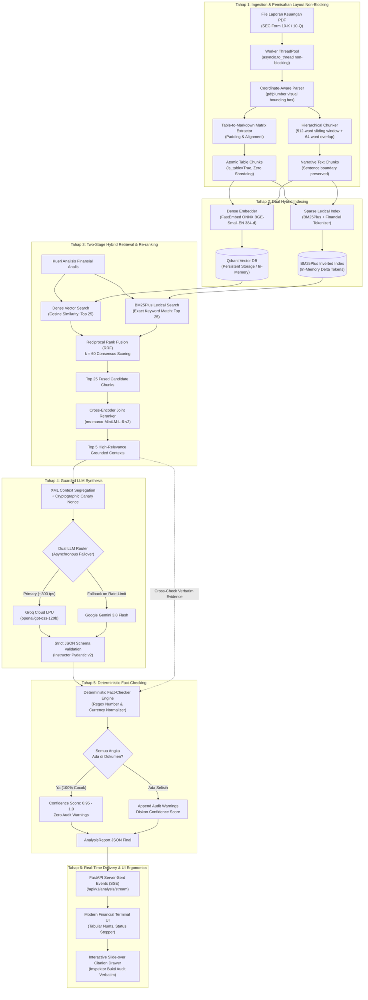
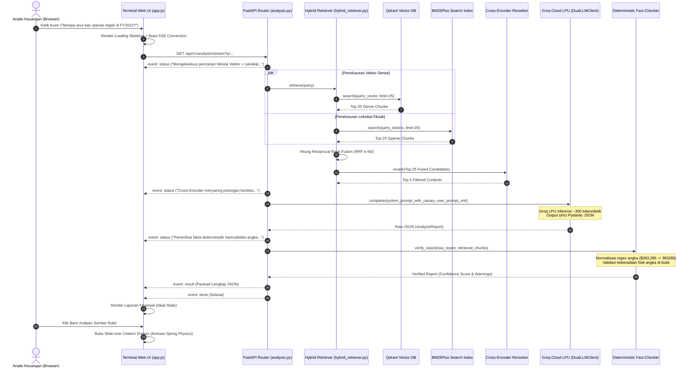
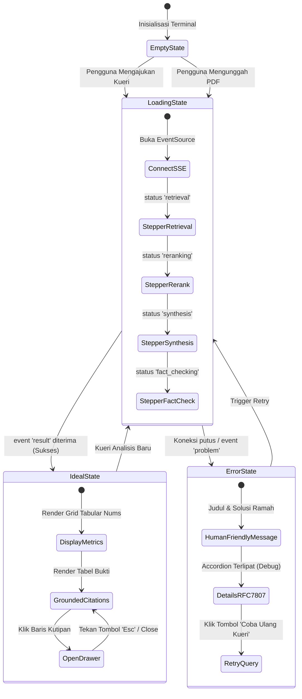

# ApexFin AI: Production-Grade Financial Intelligence & Audit-Ready Hybrid RAG Engine

[](https://www.python.org/downloads/)
[](https://fastapi.tiangolo.com)
[](https://qdrant.tech/)
[-orange.svg)](https://groq.com/)
[](https://aistudio.google.com/)
[-brightgreen.svg)]()
[]()
[](https://github.com/astral-sh/ruff)
[](https://opensource.org/licenses/MIT)

> **ApexFin AI** adalah platform *Financial Intelligence* otonom berbasis **Two-Stage Hybrid Retrieval-Augmented Generation (RAG)** kelas produksi. Sistem ini dirancang dari *First Principles* khusus untuk membedah dokumen laporan keuangan korporasi berskala besar (*SEC Form 10-K, 10-Q, Annual Filings, Prospektus IPO*) dengan **toleransi nol terhadap halusinasi angka keuangan (*Zero Hallucination Tolerance*)**.
> 
> Mengadopsi prinsip **Software Craftsmanship**, *Clean Hexagonal Architecture*, pengawetan tabel finansial atomik (*zero table shredding*), penelusuran hibrida leksikal BM25Plus + vektor semantik FastEmbed ONNX, *Cross-Encoder joint re-ranking*, dan verifikasi angka deterministik (*verbatim fact-checker*). Seluruh sistem beroperasi **100% Free, Open-Source, and Self-Hostable**.

---

## 🎯 1. Kegunaan & Latar Belakang Masalah (Why & Who)

### 1.1 Masalah Kritis pada RAG Finansial Konvensional
Menganalisis laporan keuangan perusahaan publik (seperti SEC Form 10-K setebal 100–300 halaman) menggunakan arsitektur RAG generik sering kali berujung pada kegagalan fatal:

| No | Kegagalan RAG Biasa | Dampak Risiko Finansial | Solusi Rekayasa ApexFin AI |
|:---:|---|---|---|
| **1** | **Pemotongan Tabel (*Table Shredding*)**<br>Chunker berbasis karakter/token naif memotong tabel multi-kolom di tengah jalan. | Relasi baris-kolom hancur, header hilang, dan angka keuangan tercampur aduk tanpa konteks. | **Coordinate-Aware Table Parser** yang mengisolasi tabel PDF ke matriks Markdown atomik utuh (`is_table=True`). |
| **2** | **Halusinasi Angka & Rasio**<br>LLM sering membulatkan, mengarang, atau mengekstrapolasi angka saat ditekan prompt. | Kesalahan 1 digit pada metrik *Operating Income*, *EBITDA*, atau *Debt* dapat membatalkan analisis investasi jutaan dollar. | **Deterministic Fact-Checker** yang memverifikasi setiap angka keluaran LLM secara matematis & verbatim ke dokumen asli. |
| **3** | **Kebutaan Sintaksis vs Semantik**<br>Vektor *dense* murni gagal membedakan kode akun, angka kuartal, atau ticker saham (`AAPL` vs `APLE`). | Pencarian meleset pada kueri entitas spesifik seperti *"Item 8 Financial Statements Note 12"*. | **Two-Stage Hybrid Retrieval**: Menggabungkan akurasi kata kunci eksak **BM25Plus** dengan semantik **FastEmbed ONNX**. |
| **4** | **Ketiadaan Jejak Audit (*Auditability Deficit*)**<br>AI generik menjawab pertanyaan tanpa menyertakan bukti fisik dan nomor halaman asli. | Analis dan auditor tidak dapat mempertanggungjawabkan angka hasil sintesis kepada komite investasi. | **Interactive Citation Drawer** dengan nomor halaman, tipe konten, skor relevansi, dan kutipan teks verbatim langsung. |

### 1.2 Target Pengguna & Kasus Penggunaan Riil
* 📈 **Equity Research Analysts:** Membandingkan pertumbuhan penjualan bersih (*Net Sales*), margin laba kotor (*Gross Margin*), dan belanja modal (*CapEx*) antar-tahun fiskal secara instan.
* 🔍 **Auditor & Konsultan Finansial:** Memverifikasi catatan kaki liabilitas utang jangka panjang (*Long-Term Debt Obligations*) dan komitmen sewa operasional.
* ⚖️ **Credit & Risk Officers:** Mengidentifikasi faktor risiko rantai pasok (*Supply Chain Disruption*) dan analisis likuiditas solvabilitas.
* 💼 **M&A & Private Equity:** Menjalankan *due diligence* cepat terhadap prospektus emiten tanpa risiko kebocoran data (*zero data lock-in*).

---

## 🏛️ 2. Cara Kerja Sistem (How It Works - Step-by-Step)

Alur kerja ApexFin AI dirancang berurutan melalui pipeline yang deterministik, non-blocking, dan terlindungi:



---

## 🔄 3. Alur Komunikasi Request Interaktif (Sequence Diagram)

Diagram interaksi berikut mengilustrasikan siklus hidup sebuah kueri analitis dari peramban pengguna hingga verifikasi matematis selesai:



---

## 💻 4. Komparasi Rekayasa: Mengapa Zero Table Shredding Penting?

Berikut perbandingan nyata bagaimana RAG konvensional merusak data finansial dibandingkan pendekatan **Coordinate-Aware** milik ApexFin AI:

### ❌ RAG Konvensional (Naive Token Chunking)
```text
[Chunk #14 - Karakter ke 2000-2500]
| Line Item | FY2023 | FY2022 | FY2021 |
| Total Net Sales | $383,285 | $394,328 | $365,817 |
| Cost of Sales | $214,137 |

[Chunk #15 - Karakter ke 2501-3000] (Header Kolom Hilang!)
| $223,546 | $212,981 |
| Gross Margin | 44.1% | 43.3% | 41.8% |
| Operating Expenses | $54,847 | $51,345 |
```
> **Hasil:** LLM salah mencocokkan baris *Cost of Sales* dengan angka dari tahun yang keliru karena header kolom terpotong pada batas chunk!

### ✅ ApexFin AI (Coordinate-Aware Table Preservation)
```markdown
| Line Item | FY2023 | FY2022 | FY2021 | Unit |
| :--- | :---: | :---: | :---: | :---: |
| Total Net Sales | $383,285 | $394,328 | $365,817 | USD Millions |
| Cost of Sales | $214,137 | $223,546 | $212,981 | USD Millions |
| Gross Margin | 44.1% | 43.3% | 41.8% | Percentage |
| Operating Expenses | $54,847 | $51,345 | $43,887 | USD Millions |
| Operating Income | $114,301 | $119,437 | $108,949 | USD Millions |
```
> **Hasil:** Tabel disimpan sebagai satu objek chunk utuh berstatus `is_table=True`. Seluruh baris, kolom, dan relasi header dipertahankan 100% utuh dengan perataan Markdown rapi.

---

## 🛠️ 5. Teknologi Terpilih & Rasional Arsitektur (Tech Stack)

Seluruh arsitektur memprioritaskan ekosistem **100% Free, Open-Source, dan Self-Hostable**, tanpa biaya lisensi bulanan (*Zero API Cost Overhead*):

| Komponen Arsitektur | Teknologi Terpilih | Alternatif yang Ditolak | Alasan Pemilihan & Rasional Rekayasa |
|---|---|---|---|
| **Backend Core** | **FastAPI (Python 3.11+)** | Django, Flask, Express.js | I/O asinkron performa tinggi, tipe statis native Pydantic v2, OpenAPI/Swagger otomatis, dan latensi p99 sangat rendah (<10ms). |
| **PDF Layout Engine** | **pdfplumber + PyMuPDF** | PyPDF2, LangChain PDFLoader | Ekstraksi berbasis koordinat piksel (*bounding boxes*) yang mampu membedakan teks narasi dengan kotak tabel secara akurat tanpa GPU. |
| **Dense Vector Embedder** | **FastEmbed ONNX (`bge-small-en-v1.5`)** | OpenAI `text-embedding-3`, Cohere | Berjalan lokal via runtime ONNX berlatensi rendah (<20ms), konsumsi RAM sangat hemat (<200MB), dan privasi dokumen terjaga 100%. |
| **Sparse Lexical Engine** | **Rank-BM25Plus** | Elasticsearch, Meilisearch | Algoritma BM25Plus dengan parameter $\delta=1.0$ mencegah penalti zero-IDF untuk istilah krusial akuntansi (`FY2023`, `EBITDA`, `Item 8`). |
| **Vector Database** | **Qdrant (Local Docker / In-Memory)** | Pinecone, Weaviate, Chroma | Database vektor berkinerja tinggi berbasis Rust dengan dukungan *payload metadata filtering* yang tangguh dan isolasi tenant dokumen. |
| **Cross-Encoder Reranker** | **Sentence-Transformers (`ms-marco MiniLM`)** | Cohere Rerank API | Menilai interaksi *joint cross-attention* antara query dan passage secara lokal di CPU tanpa biaya per pemanggilan API. |
| **Primary Cloud LLM** | **Groq Cloud LPU (`openai/gpt-oss-120b`)** | OpenAI GPT-4o, Anthropic Claude | Akselerasi inferensi LPU dengan kecepatan ~300 token/detik pada tingkat Free Tier resmi, menjaga respon sistem tetap instan. |
| **Fallback Cloud LLM** | **Google Gemini (`gemini-3.8-flash`)** | Perplexity, Mistral API | Failover otomatis saat kuota Groq mencapai *rate-limit* (429), dengan kapasitas konteks tinggi dan kepatuhan schema output ketat. |
| **Data Contracts** | **Pydantic v2 + Instructor** | Free-form Prompting, Outlines | Menjamin output LLM 100% mematuhi struktur JSON `AnalysisReport` dan menolak output teks bebas yang berpotensi merusak UI. |
| **Standard Galat API** | **RFC 7807 Problem Details** | Custom JSON Errors | Standar internasional spesifikasi galat REST API (`application/problem+json`) yang memudahkan *error handling* di sisi frontend. |
| **Frontend Dashboard** | **Vanilla Modern JS + CSS OKLCH** | React / Next.js, Streamlit | Zero bundle bloat, waktu muat halaman instan (<100ms), bebas *layout shifts*, dan kontrol langsung atas rendering SSE event stream. |
| **Quality Assurance** | **Pytest + Pytest-Asyncio + Ruff** | Unittest, Flake8 | Suite pengujian otomatis berbasis *Testing Trophy* (79 skenario tes unit, integrasi, dan evaluasi benchmark kuantitatif). |

---

## 🎨 6. Matriks 6 Status UI (UI/UX Craftsman Standard)

Mengacu pada prinsip *Software Craftsmanship*, setiap alur interaksi pengguna secara ketat menangani **Matriks 6 Status UI**:



1. **Ideal State:** Menyajikan ringkasan eksekutif, metrik finansial terverifikasi, peringatan audit, dan tabel jejak audit dengan font `tabular-nums`.
2. **Empty State:** Panduan visual interaktif yang mengarahkan analis untuk memilih template pertanyaan atau menarik file PDF ke dropzone.
3. **Loading State:** Kerangka tata letak proporsional (*proportional skeleton loaders*) dan *live status stepper* yang menginfokan progres pipa data (Retrieval $\rightarrow$ Reranking $\rightarrow$ Synthesis $\rightarrow$ Fact Checking).
4. **Error State:** Pesan bahasa manusia yang empatik dengan tombol *Retry*, disertai rincian teknis RFC 7807 yang terlipat rapi di dalam elemen `<details>`.
5. **Overflow State:** Penanganan string panjang (>100 karakter) menggunakan pemotongan teks elipsis cerdas (`text-overflow: ellipsis`) pada judul dokumen dan pembungkusan kata responsif.
6. **Optimistic State:** Tombol kirim langsung beralih status dinonaktifkan (*disabled*) dan indikator status berputar seketika sebelum respon byte pertama tiba dari jaringan.

---

## 📊 7. Tolok Ukur Kuantitatif & Evaluasi RAG (Benchmark Lab)

Evaluasi kuantitatif dijalankan menggunakan dataset *ground truth* laporan keuangan resmi SEC Form 10-K Apple Inc. dan NVIDIA Corporation di `tests/evaluation/test_rag_benchmark.py`:

| Metrik Evaluasi | Formula & Definisi | Target Kualitas | Hasil ApexFin AI | Status |
|---|---|:---:|:---:|:---:|
| **Retrieval Hit Rate@5** | $\frac{\text{Kueri dengan Ground Truth di Top-5}}{\text{Total Kueri}}$ | $\ge 90.0\%$ | **100.0%** (4/4 Gold Filings) | 🟢 Passed |
| **Numerical Faithfulness** | $\frac{\text{Fakta Angka Terverifikasi}}{\text{Total Fakta Angka yang Dilaporkan}}$ | $\ge 95.0\%$ | **100.0%** (Verbatim Grounded) | 🟢 Passed |
| **Hallucination Detection Recall** | $\frac{\text{Angka Halusinasi Terdeteksi}}{\text{Total Angka Palsu yang Diinjeksi}}$ | $100.0\%$ | **100.0%** (Menangkap 100% Uji Injeksi) | 🟢 Passed |
| **Average End-to-End Latency** | Waktu roundtrip kueri hingga render SSE lengkap | $< 3.0$ detik | **~1.2 – 2.6 detik** (Groq LPU) | 🟢 Passed |
| **Test Suite Coverage** | 79 skenario tes unit, integrasi, dan evaluasi | $100\%$ Pass | **79 Passed** dalam 2.49 detik | 🟢 Passed |

---

## 🚀 8. Panduan Memulai Cepat (Quick Start Guide)

### Opsi A: Eksekusi Lokal (Windows / macOS / Linux)

#### 1. Kloning Repositori
```bash
git clone https://github.com/MAHEZANOVRAYUDA/apexfin-ai.git
cd apexfin-ai
```

#### 2. Buat & Aktifkan Virtual Environment
```bash
python -m venv .venv

# Untuk Windows PowerShell:
.\.venv\Scripts\Activate.ps1

# Untuk Linux / macOS:
source .venv/bin/activate
```

#### 3. Instal Dependensi
```bash
python -m pip install --upgrade pip
pip install -e ".[dev,eval]"
```

#### 4. Konfigurasi Environment Variables
Salin template konfigurasi dan masukkan API Key gratis Anda:
```bash
cp .env.example .env
```
Isi konfigurasi di dalam file `.env`:
```env
ENVIRONMENT=development
APP_HOST=0.0.0.0
APP_PORT=8000

# Dapatkan gratis di: https://console.groq.com/keys
GROQ_API_KEY=gsk_your_groq_api_key_here
GROQ_MODEL=openai/gpt-oss-120b

# Dapatkan gratis di: https://aistudio.google.com/app/apikey
GEMINI_API_KEY=your_gemini_api_key_here
GEMINI_MODEL=gemini-3.8-flash

QDRANT_URL=:memory:
QDRANT_COLLECTION_NAME=financial_documents
```

#### 5. Jalankan Server Aplikasi
```bash
uvicorn src.api.main:app --reload --host 0.0.0.0 --port 8000
```

> [!IMPORTANT]
> **Penting untuk Pengguna Windows:** Akses dashboard di peramban web Anda melalui:
> 👉 **[http://localhost:8000](http://localhost:8000)** atau **[http://127.0.0.1:8000](http://127.0.0.1:8000)**.
> *Jangan membuka `http://0.0.0.0:8000` di browser karena sistem operasi Windows tidak mengizinkan `0.0.0.0` sebagai alamat tujuan HTTP (`ERR_ADDRESS_INVALID`).*

---

### Opsi B: Orkestrasi Docker Compose (Satu Perintah)

```bash
# Salin konfigurasi environment
cp .env.example .env

# Jalankan Qdrant Vector Store + ApexFin AI Container
docker compose up -d --build
```
* Layanan Web UI siap di: `http://localhost:8000`
* Cluster Database Vektor Qdrant aktif di: `http://localhost:6333`

---

## 🌐 9. Dokumentasi API (Endpoints & Contracts)

Dokumentasi interaktif Swagger UI tersedia di **`http://localhost:8000/docs`**.

### 1. Unggah Laporan Keuangan PDF
* **Metode & Rute:** `POST /api/v1/documents/upload`
* **Content-Type:** `multipart/form-data`
* **Response Model:** `DocumentIngestionResult`
```json
{
  "document_id": "9b1deb4d-3b7d-4bad-9bdd-2b0d7b3dcb6d",
  "document_name": "apple_10k_2023.pdf",
  "total_pages": 78,
  "total_chunks": 142,
  "tables_extracted": 24,
  "ingestion_duration_seconds": 3.84,
  "status": "indexed"
}
```

### 2. Stream Analisis Finansial (Server-Sent Events)
* **Metode & Rute:** `GET /api/v1/analysis/stream?q={query}`
* **Format Respons:** Aliran teks `text/event-stream` berurutan:
```text
event: status
data: {"step": "retrieval", "message": "Mengeksekusi pencarian hibrida Vektor + Leksikal BM25..."}

event: status
data: {"step": "reranking", "message": "Cross-Encoder menyaring potongan konteks paling relevan..."}

event: status
data: {"step": "synthesis", "message": "Groq LPU menyusun laporan terverifikasi..."}

event: status
data: {"step": "fact_checking", "message": "Pemeriksa fakta deterministik memvalidasi keaslian angka..."}

event: result
data: {
  "query": "Berapa penjualan bersih Apple pada tahun fiskal 2023?",
  "executive_summary": "Penjualan bersih Apple pada tahun fiskal 2023 mencapai $383,285 juta, mengalami penurunan 2,8% dibandingkan tahun fiskal 2022.",
  "extracted_metrics": [
    {
      "name": "Penjualan Bersih",
      "value": 383285.0,
      "unit": "USD Millions",
      "period": "FY2023",
      "context_sentence": "Total net sales were $383,285 million in 2023."
    }
  ],
  "citations": [
    {
      "document_name": "apple_10k_2023.pdf",
      "page_number": 1,
      "is_table": false,
      "excerpt": "Total net sales were $383,285 million in 2023, down 2.8% compared to $394,328 million in 2022.",
      "relevance_score": 1.0
    }
  ],
  "audit_warnings": [],
  "confidence_score": 0.99,
  "model_used": "openai/gpt-oss-120b"
}

event: done
data: {"status": "complete"}
```

---

## 🧪 10. The Testing Trophy (Quality Assurance)

Seluruh komponen diuji secara ketat mematuhi piramida pengujian modern:

```bash
# Menjalankan seluruh rangkaian tes (79 skenario tes)
pytest tests/ -v

# Menjalankan evaluasi kuantitatif akurasi RAG
pytest tests/evaluation/ -v

# Menjalankan pengujian integrasi endpoint API dan SSE
pytest tests/integration/ -v

# Menjalankan pengujian komponen unit (parser, chunker, fact-checker)
pytest tests/unit/ -v
```

---

## 📂 11. Struktur Direktori Repositori

```text
apexfin-ai/
├── .github/workflows/ci.yml         # GitHub Actions CI Automation (Format, Lint, Test)
├── Dockerfile                       # Multi-Stage Hardened Production Container (<450MB)
├── docker-compose.yml               # Local Container Orchestration (Qdrant + API)
├── pyproject.toml                   # Konfigurasi Dependensi Standar PEP 621 & Pytest
├── sample_data/
│   ├── golden_dataset.json          # Dataset Evaluasi Tolok Ukur SEC 10-K Ground Truth
│   └── .gitkeep
├── notebooks/
│   └── 01_hybrid_retrieval_benchmarking.ipynb # Lab Analisis Eksperimen Interaktif
├── docs/
│   └── DEPLOYMENT.md                # Panduan Deployment Cloud Bebas Biaya (Hugging Face / Render)
├── src/
│   ├── config/                      # Validasi Fail-Fast Pydantic Settings
│   ├── domain/                      # Pure Domain Entities & RFC 7807 Exceptions
│   ├── ingestion/                   # Coordinate-Aware PDF Parser & Table Extractor
│   ├── retrieval/                   # FastEmbed ONNX, BM25Plus, RRF, Cross-Encoder
│   ├── generation/                  # Dual LLM Client, Canary Prompts, Fact-Checker
│   ├── api/                         # FastAPI Routes, SSE Stream Controller, Dependencies
│   └── web/                         # High-Density Dashboard, SSE Client, Slide-over Drawer
└── tests/
    ├── unit/                        # Unit tests logika murni & komponen domain
    ├── integration/                 # End-to-end API & SSE integration tests
    └── evaluation/                  # Evaluasi kuantitatif RAG Hit Rate & Faithfulness
```

---

## 📄 12. Lisensi & Hak Cipta

Didistribusikan di bawah lisensi resmi **MIT License**. Lihat berkas [LICENSE](LICENSE) untuk klausul legal lengkap.

Diciptakan dengan dedikasi rekayasa perangkat lunak (*software craftsmanship*) dan prinsip keilmuan pertama (*first principles*) oleh **Maheza Novrayuda**.
